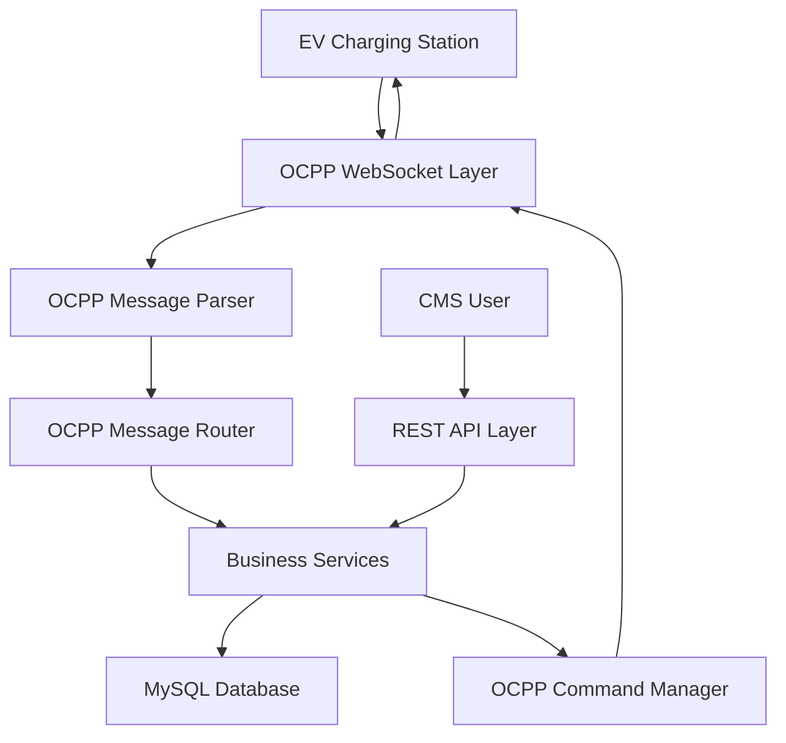
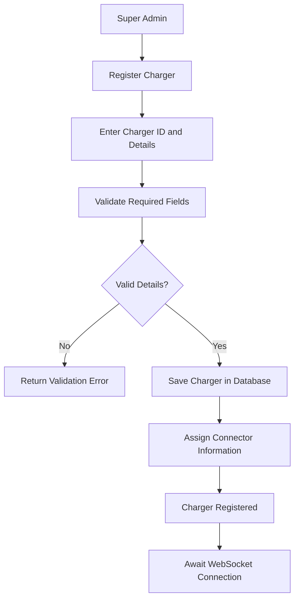
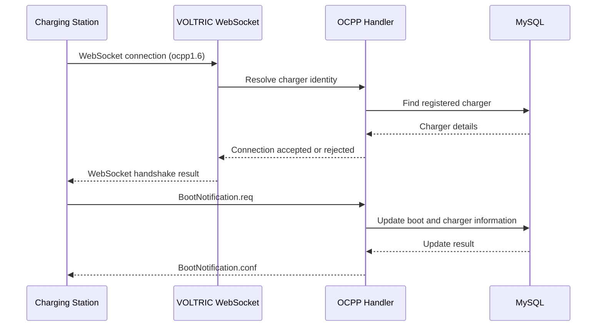
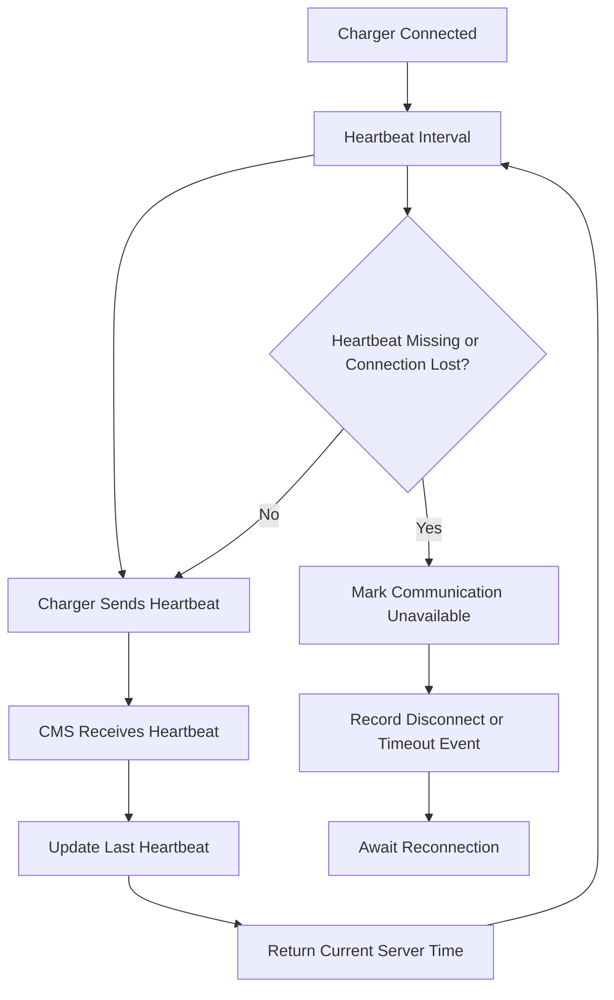
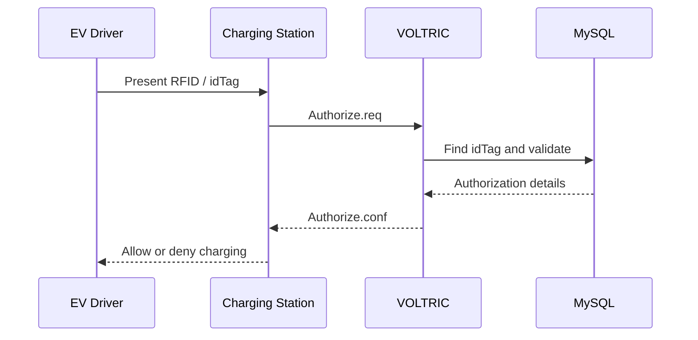
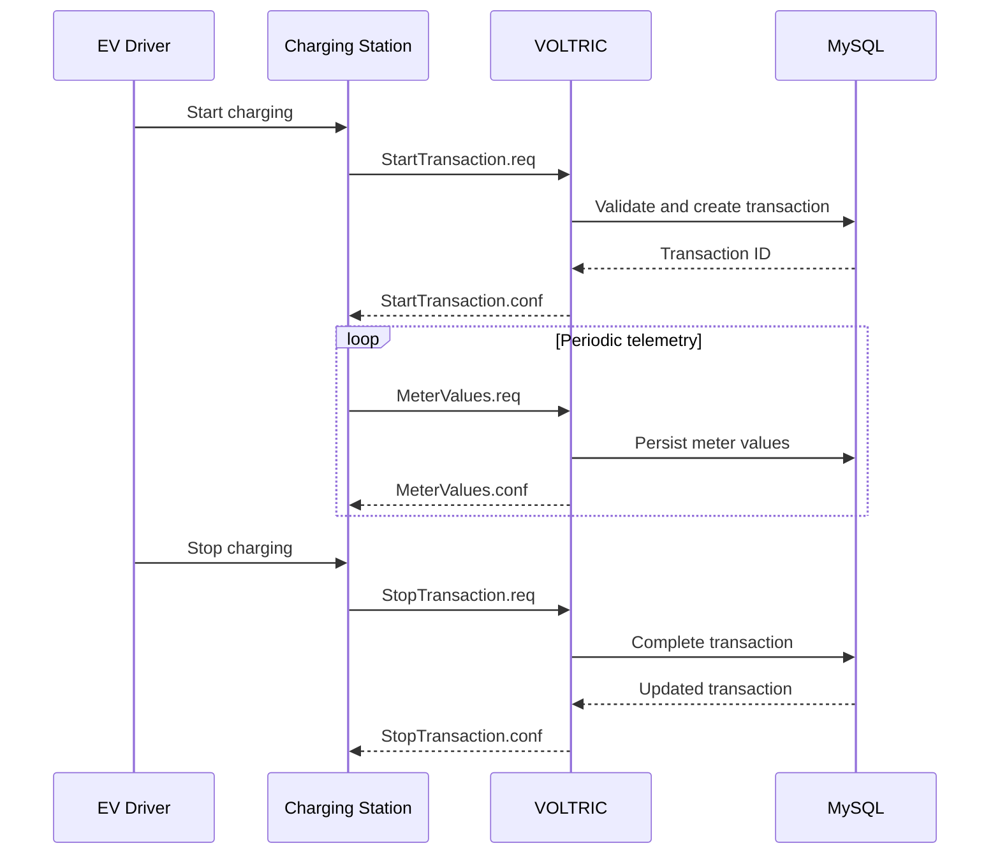
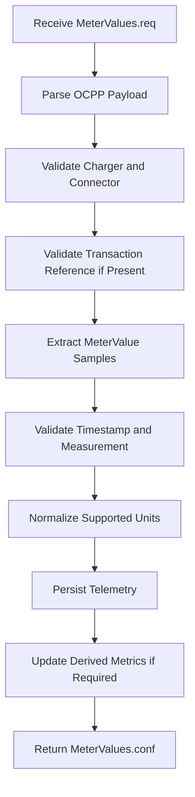
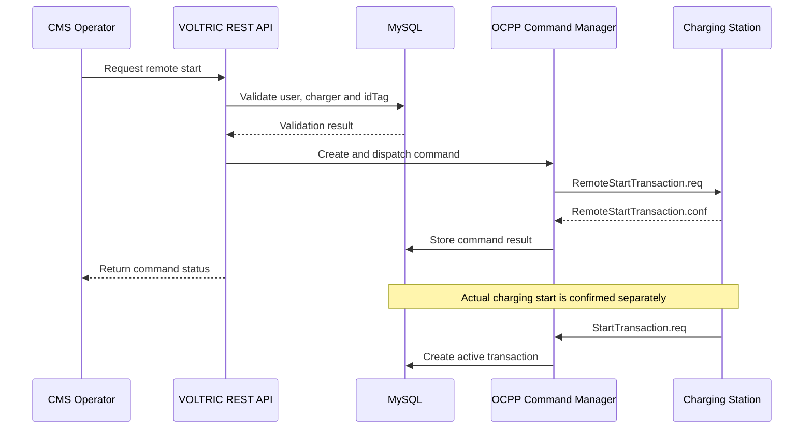
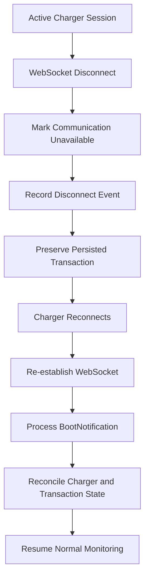
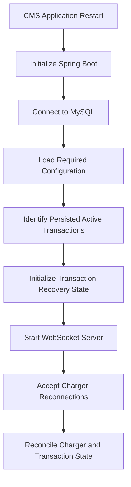

# VOLTRIC – System Workflow Design

**Document:** 06 – System Workflow Design  
**Project:** VOLTRIC – EV Charging Station Management System  
**Version:** 1.0  
**Architecture:** Single-organization  
**Protocol:** OCPP 1.6J over WebSocket  
**Initial Capacity:** 100 simultaneous charger connections  
**Status:** Draft for review

---

## 1. Purpose

This document defines the end-to-end operational workflows of VOLTRIC.

It describes how the EV charging station, CMS backend, database, and CMS users interact during normal operations and failure scenarios.

The objective is to establish clear workflows before implementing the corresponding Spring Boot services, WebSocket handlers, REST APIs, and database operations.

## 2. System Participants

| Participant | Responsibility |
|---|---|
| EV Driver | Presents RFID/idTag and uses the charging station |
| EV Charging Station | Communicates with VOLTRIC through OCPP 1.6J |
| VOLTRIC CMS Backend | Processes OCPP messages and manages charging operations |
| MySQL Database | Stores charger, connector, transaction, telemetry, and user data |
| Super Administrator | Manages users, chargers, idTags, configurations, and operations |
| Charging Station Operator | Monitors assigned chargers and performs authorized remote operations |
| System Administrator | Manages infrastructure, deployment, backups, and application health |

## 3. High-Level System Workflow

### Explanation

1. Chargers establish OCPP WebSocket connections with VOLTRIC.
2. The communication layer receives incoming OCPP frames.
3. The parser identifies the message type, message ID, action, and payload.
4. The router forwards messages to the appropriate handler.
5. Business services perform validation and business operations.
6. Required information is persisted in MySQL.
7. CMS users interact through REST APIs.
8. Remote commands are dispatched through the OCPP command manager to the relevant charger.

## 4. Workflow 1 – Charger Registration

### Objective

Ensure that only chargers recognized by VOLTRIC's registration policy are allowed to become operational.

### Workflow

### Processing steps

1. Super Admin submits charger registration details.
2. CMS validates the unique charger identity and required information.
3. CMS stores the charger record.
4. Connector information is configured according to the charger's capabilities.
5. The charger becomes eligible to connect.
6. The CMS waits for the charger's OCPP WebSocket connection.

### Expected result

- Charger details are stored.
- Duplicate charger identities are rejected.
- Connector records are associated with the correct charger.
- The charger is registered but not automatically considered online.

## 5. Workflow 2 – Charger Connection and BootNotification

### Objective

Establish an OCPP session and initialize charger communication.

### Workflow

### Processing steps

1. Charger opens a WebSocket connection.
2. VOLTRIC extracts the charger identity from the configured endpoint.
3. CMS checks whether the charger is registered and permitted to connect.
4. If permitted, the WebSocket session is established.
5. Charger sends BootNotification.
6. CMS validates the payload and updates relevant charger metadata.
7. CMS returns the BootNotification response with status, current time, and heartbeat interval.
8. The charger follows the returned interval when its status is Accepted.

### Expected result

- Charger identity is associated with its active WebSocket session.
- Boot information is stored.
- Charger initialization status is updated.
- An unregistered or rejected charger is not treated as operational.

**Important:** WebSocket connection establishment and BootNotification acceptance are separate events. A connected WebSocket session does not by itself prove that the charger has been accepted by the CMS.

## 6. Workflow 3 – Heartbeat and Connection Monitoring

### Objective

Monitor charger communication and detect stale or disconnected sessions.

### Workflow

### Processing steps

1. Charger periodically sends Heartbeat.
2. CMS receives the request.
3. CMS updates the last heartbeat timestamp.
4. CMS returns current server time.
5. If a connection closes or the configured monitoring timeout expires, CMS marks communication as unavailable.
6. CMS records the event.
7. A reconnecting charger goes through the connection and initialization process again.

### Expected result

- Last heartbeat information is available.
- Lost connections can be detected.
- Charger communication status is not confused with connector charging status.

**Important:** Do not overwrite a connector's Charging or Faulted status simply because the charger has sent a Heartbeat. Communication state and operational state should be tracked separately.

## 7. Workflow 4 – RFID Authorization

### Objective

Validate a driver's idTag before allowing a charging session.

### Workflow

### Processing steps

1. Driver presents an RFID card.
2. Charger extracts the idTag.
3. Charger sends Authorize.req.
4. CMS validates the idTag against stored authorization information.
5. CMS checks the idTag's status and applicable validity restrictions.
6. CMS returns the authorization result.
7. Charger uses the response according to its configuration and protocol behavior.

### Expected result

- Valid idTags receive Accepted.
- Blocked, expired, or unknown idTags receive the appropriate negative status.
- Authorization events can be audited.

**Important:** Authorization does not create a transaction. The actual charging transaction is handled through StartTransaction.

## 8. Workflow 5 – Charging Transaction Lifecycle

### Objective

Manage the complete charging session from transaction creation to completion.

### Workflow

### Start transaction processing

1. Charger sends StartTransaction.
2. CMS identifies the charger and connector.
3. CMS validates the idTag and transaction conditions.
4. CMS verifies that the connector and transaction state permit the operation.
5. CMS creates the transaction record.
6. CMS generates a transaction ID.
7. CMS stores the initial meter reading and start timestamp.
8. CMS returns StartTransaction.conf.

### Active transaction processing

1. Charger sends MeterValues periodically.
2. CMS validates the transaction association.
3. CMS stores the measurements.
4. CMS updates derived telemetry or transaction summaries as required.
5. The transaction remains active until a valid stop event is processed.

### Stop transaction processing

1. Charger sends StopTransaction.
2. CMS locates the corresponding active transaction.
3. CMS validates the final meter reading and timestamp.
4. CMS calculates energy consumed when readings are valid.
5. CMS marks the transaction as completed.
6. CMS stores stop time, stop reason, and final reading.
7. CMS returns StopTransaction.conf.

### Expected result

A completed transaction contains:
- Transaction ID.
- Charger ID.
- Connector ID.
- idTag reference, where available.
- Start and stop timestamps.
- Initial and final meter readings.
- Calculated energy consumption.
- Final transaction status.

### Energy calculation

When both readings use Wh:

\[
EnergyConsumed_{kWh} =
\frac{MeterStop_{Wh}-MeterStart_{Wh}}{1000}
\]

The calculation must validate units, reading order, and meter-reset or rollover conditions before accepting the result.

## 9. Workflow 6 – MeterValues and Telemetry Processing

### Objective

Receive, validate, normalize, and persist charger measurements.

### Workflow

### Processing steps

1. Charger sends MeterValues.
2. CMS parses the meterValue array.
3. CMS validates the charger and connector references.
4. If a transaction ID is supplied, CMS validates the transaction association.
5. CMS iterates through each sampled value.
6. CMS identifies the measurand, unit, context, phase, and timestamp where supplied.
7. CMS validates and normalizes supported values.
8. CMS persists the measurements.
9. CMS returns a successful OCPP response when processing succeeds.

### Expected result

- Multiple sampled values in one message are handled.
- Supported measurements are stored with their original timestamps and units.
- Unsupported measurements are handled safely.
- Invalid samples are logged and handled according to the message validation policy.

## 10. Workflow 7 – Remote Charger Management

### Objective

Allow authorized CMS users to request charger operations through OCPP.

### 10.1 RemoteStartTransaction

### Processing steps

1. Operator submits a remote-start request.
2. CMS authenticates the operator.
3. CMS checks permissions and validates charger, connector, and idTag.
4. CMS verifies that the charger has an active communication session.
5. CMS creates a remote command record.
6. CMS sends RemoteStartTransaction.req.
7. CMS waits for the corresponding response or timeout.
8. CMS records Accepted, Rejected, timeout, or failure.
9. If the charger subsequently starts charging, StartTransaction is processed separately.

### 10.2 RemoteStopTransaction

1. Operator selects an active transaction.
2. CMS validates permissions and transaction ownership.
3. CMS identifies the associated charger.
4. CMS creates a remote command record.
5. CMS sends RemoteStopTransaction.req with the transaction ID.
6. CMS records the charger's response or timeout.
7. Charger sends StopTransaction if the transaction actually stops.
8. CMS completes the transaction using the final meter reading and timestamp.

**Important:** A successful remote command response is not proof that the physical charging session has completed.

## 11. Workflow 8 – Charger Disconnection and Recovery

### Objective

Handle network failures and CMS restarts without losing persisted transaction information.

### 11.1 Charger network disconnection

### Processing steps

1. CMS detects the WebSocket disconnection.
2. CMS updates communication state.
3. CMS preserves active transaction records.
4. Charger attempts reconnection.
5. CMS re-establishes the WebSocket session.
6. Charger sends BootNotification.
7. CMS updates charger communication information.
8. CMS reconciles persisted transaction state with subsequent charger messages.

### 11.2 CMS application restart

### Recovery rules

- Transactions must be persisted before the CMS acknowledges the relevant successful transaction operation.
- Active transaction records must survive an application restart.
- A CMS restart must not automatically mark every active transaction as completed.
- A reconnecting charger must not create a duplicate transaction for an already-active session.
- Recovery must use transaction IDs, charger identity, connector identity, and subsequent OCPP events to reconcile state.
- A transaction must not be marked completed without an appropriate stop event or a separately defined reconciliation policy.

## 12. State Management

VOLTRIC must distinguish three separate types of state.

### 12.1 Communication state

Examples:
- CONNECTED
- DISCONNECTED
- RECONNECTING

### 12.2 Charger operational state

Examples:
- Available
- Preparing
- Charging
- SuspendedEV
- SuspendedEVSE
- Finishing
- Reserved
- Unavailable
- Faulted

These are OCPP 1.6 connector status values. Connector ID 0 is used for charge-point-level status notifications.

### 12.3 Transaction state

Initial VOLTRIC business states:
- ACTIVE
- COMPLETED

Additional states such as RECOVERY_REQUIRED or FAILED may be introduced after defining their business semantics.

These states must not be merged into a single status column because communication availability, connector condition, and transaction lifecycle represent different concepts.

## 13. Proposed Business Rules

| Rule ID | Business rule |
|---|---|
| WF-001 | A charger must satisfy the registration policy before it becomes an accepted operational charger. |
| WF-002 | A WebSocket connection alone does not mean the charger has completed boot initialization. |
| WF-003 | Authorization and transaction creation are separate operations. |
| WF-004 | A transaction must be associated with the correct charger and connector. |
| WF-005 | One connector must not have conflicting active transactions under the V1 business policy. |
| WF-006 | Duplicate transaction events must not create unintended duplicate business records. |
| WF-007 | Remote command acceptance does not guarantee physical execution. |
| WF-008 | Transaction completion must be based on valid stop processing or an explicitly defined reconciliation policy. |
| WF-009 | Communication state must be tracked independently from connector operational state. |
| WF-010 | Persisted transaction records must survive CMS application restarts. |

## 14. Workflow-to-Backend Component Mapping

| Workflow | Main proposed backend components |
|---|---|
| Charger registration | ChargerController, ChargerService, ChargerRepository |
| WebSocket connection | OcppWebSocketHandler, ChargerSessionManager |
| BootNotification | BootNotificationHandler, ChargerService |
| Heartbeat | HeartbeatHandler, ChargerConnectionService |
| StatusNotification | StatusNotificationHandler, ConnectorService |
| Authorization | AuthorizeHandler, AuthorizationService |
| Transaction lifecycle | StartTransactionHandler, StopTransactionHandler, TransactionService |
| Meter telemetry | MeterValuesHandler, MeterValueService |
| Remote operations | RemoteCommandService, RemoteCommandController |
| Recovery | TransactionRecoveryService, ChargerSessionManager |
| Configuration | ChargerConfigurationService |

These are logical component names. Final packages, class names, and interfaces will be determined during Phase 2.

## 15. Workflow Verification Matrix

| Test ID | Workflow | Verification |
|---|---|---|
| WF-TC-01 | Charger registration | Duplicate charger registration is rejected |
| WF-TC-02 | WebSocket connection | Registered charger establishes a valid session |
| WF-TC-03 | BootNotification | Charger initialization and response are correct |
| WF-TC-04 | Heartbeat | Last heartbeat is updated |
| WF-TC-05 | RFID authorization | Valid and invalid idTags receive correct results |
| WF-TC-06 | Start transaction | Transaction is created correctly |
| WF-TC-07 | MeterValues | Measurements are validated and persisted |
| WF-TC-08 | Stop transaction | Transaction is completed and energy is calculated |
| WF-TC-09 | Remote start | Command response and actual transaction start are tracked separately |
| WF-TC-10 | Remote stop | Command response and transaction completion are tracked separately |
| WF-TC-11 | Charger disconnection | Communication loss is detected without corrupting transaction data |
| WF-TC-12 | CMS restart | Persisted active transaction information is recovered |
| WF-TC-13 | Multiple chargers | Independent charger sessions do not interfere with one another |
| WF-TC-14 | Multiple connectors | Separate connector transactions are handled correctly |

## 16. Dependencies

| Document | Relationship |
|---|---|
| 01 – Project Vision and Scope | Establishes the project boundary |
| 02 – Stakeholder Analysis | Establishes user roles and responsibilities |
| 03 – Functional Requirements | Defines the required system features |
| 04 – Non-Functional Requirements | Defines quality and operational expectations |
| 05 – OCPP Scope and Message Matrix | Defines the protocol operations |
| 06 – System Workflow Design | Defines end-to-end processing sequences |

## 17. Acceptance Criteria

Step 6 is complete when:

1. All major V1 workflows are documented.
2. Charger connection and boot initialization are clearly separated.
3. Authorization and transaction creation are clearly separated.
4. Start, meter-value, and stop transaction processing is defined.
5. Remote command responses are distinguished from actual charger outcomes.
6. Charger disconnection and CMS restart recovery are documented.
7. Communication, connector, and transaction states are separated.
8. Workflow verification scenarios are defined.
9. The document is reviewed and merged into `main`.

**Phase 1 deliverable:** `docs/06_System_Workflow_Design.md`