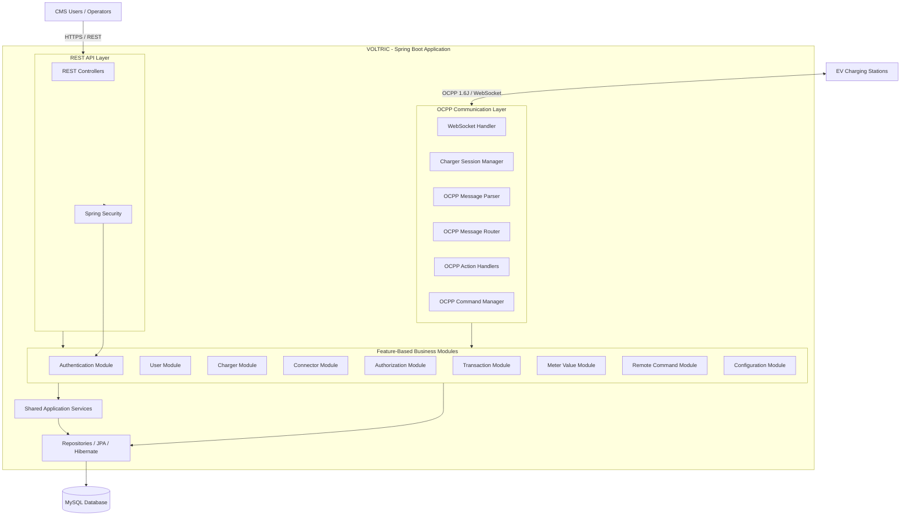
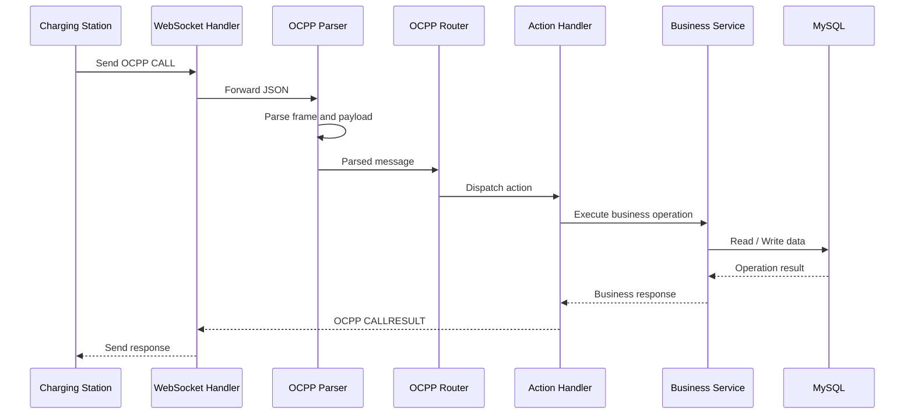
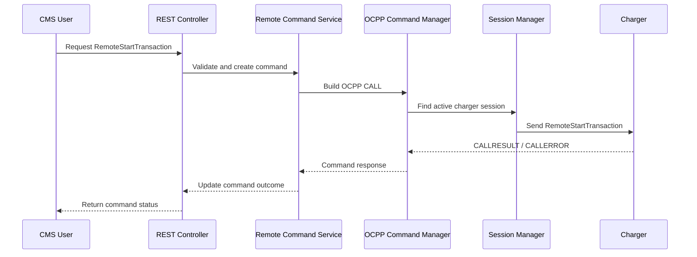

# VOLTRIC – High-Level System Architecture (HLD)

**Project:** VOLTRIC – EV Charging Station Management System  
**Version:** 1.0  
**Architecture:** Feature-Based Modular Monolith  
**Backend:** Java 21 + Spring Boot  
**Database:** MySQL  
**Communication Protocol:** OCPP 1.6J over WebSocket  
**Initial Capacity Target:** 100 simultaneously connected chargers  
**Deployment Scope:** Single organization

---

## 1. Introduction

VOLTRIC is a centralized EV Charging Station Management System (CMS) designed to monitor, manage, and remotely control EV charging stations through the Open Charge Point Protocol (OCPP) 1.6J.

The platform provides a central backend that communicates with charging stations, processes charging events, manages charging transactions, stores telemetry, and exposes REST APIs for CMS operations.

The V1 architecture follows a **Feature-Based Modular Monolith** approach. All backend modules run within one Spring Boot application but are separated according to their business responsibilities.

The OCPP communication layer is maintained independently from business modules to ensure that protocol handling and business processing remain separate.

## 2. Architecture Objectives

The architecture must:

1. Support OCPP 1.6J communication over WebSocket.
2. Manage multiple charging stations and their connectors.
3. Handle charging authorization and transaction lifecycles.
4. Process and persist meter readings.
5. Support remote charger commands.
6. Provide REST APIs for CMS operations.
7. Maintain secure access through role-based authorization.
8. Support an initial test target of 100 simultaneously connected chargers.
9. Provide maintainable module boundaries and testable components.
10. Support future expansion without requiring an immediate microservices migration.

## 3. Architectural Style

### 3.1 Feature-Based Modular Monolith

VOLTRIC V1 will use a single deployable Spring Boot application divided into independent business modules.

Each module owns a particular business capability and contains its own relevant controllers, services, repositories, entities, DTOs, and supporting classes.

The OCPP package is a separate communication subsystem responsible for handling protocol-level interactions.

### 3.2 Why this architecture?

- Simpler deployment than microservices.
- No initial distributed-service communication overhead.
- Easier debugging and local development.
- Clear separation of business capabilities.
- Supports independent testing of modules.
- Allows future extraction of selected modules if actual scale and operational needs justify it.

**Important:** Separate packages do not automatically guarantee module independence. Dependencies must be controlled through clearly defined service interfaces and dependency rules.

## 4. Technology Stack

| Layer | Technology |
|---|---|
| Programming language | Java 21 |
| Backend framework | Spring Boot |
| Build management | Maven |
| REST APIs | Spring Web |
| Charger communication | Spring WebSocket |
| Protocol | OCPP 1.6J JSON |
| ORM | Spring Data JPA / Hibernate |
| Database | MySQL |
| Database migration | Flyway |
| Security | Spring Security |
| Authentication | JWT-based CMS authentication (implementation decision to be finalized) |
| Logging | SLF4J + Logback |
| Testing | JUnit 5 + Mockito |
| API testing | Postman |
| Version control | Git + GitHub |

## 5. High-Level System Architecture

The platform consists of the following major components:

1. EV Charging Stations
2. OCPP Communication Layer
3. Business Modules
4. REST API Layer
5. Persistence Layer
6. MySQL Database
7. CMS Users and Operators

### 5.1 Architecture Diagram



## 6. Selected Backend Folder Structure

This is the official package structure for VOLTRIC V1.

```text
VOLTRIC/
│
├── src/
│   │
│   ├── main/
│   │   │
│   │   ├── java/com/voltric/cms/
│   │   │   │
│   │   │   ├── VoltricApplication.java
│   │   │   │
│   │   │   ├── common/
│   │   │   │   ├── config/
│   │   │   │   ├── exception/
│   │   │   │   ├── response/
│   │   │   │   └── util/
│   │   │   │
│   │   │   ├── modules/
│   │   │   │   │
│   │   │   │   ├── authentication/
│   │   │   │   ├── user/
│   │   │   │   ├── charger/
│   │   │   │   ├── connector/
│   │   │   │   ├── authorization/
│   │   │   │   ├── transaction/
│   │   │   │   ├── metervalue/
│   │   │   │   ├── remotecommand/
│   │   │   │   └── configuration/
│   │   │   │
│   │   │   └── ocpp/
│   │   │       ├── websocket/
│   │   │       ├── protocol/
│   │   │       ├── message/
│   │   │       ├── handler/
│   │   │       ├── router/
│   │   │       └── session/
│   │   │
│   │   └── resources/
│   │       ├── application.yml
│   │       └── db/
│   │           └── migration/
│   │
│   └── test/
│       └── java/com/voltric/cms/
│
├── docs/
├── .gitignore
├── pom.xml
└── README.md
```

### 6.1 Internal Structure of Business Modules

Each business module follows a consistent internal organization.

Example: Transaction module.

```text
transaction/
│
├── controller/
├── service/
├── repository/
├── entity/
├── dto/
├── mapper/
└── enums/
```

Not every module must contain every package. Packages should be introduced when they have a real responsibility, rather than creating empty folders in advance.

### 6.2 Responsibility of Each Module

| Module | Responsibility |
|---|---|
| authentication | CMS login, token handling and authentication |
| user | CMS users, roles and access management |
| charger | Charger registration, identity and lifecycle |
| connector | Connector information and operational status |
| authorization | RFID/idTag authorization |
| transaction | Start, update, stop and recover transactions |
| metervalue | Meter readings and telemetry processing |
| remotecommand | Remote start, stop, reset and unlock operations |
| configuration | Charger configuration and configuration changes |
| ocpp | WebSocket communication and OCPP message processing |
| common | Shared configuration, exceptions, responses and utilities |

## 7. OCPP Communication Layer

The OCPP layer is responsible for communication between VOLTRIC and charging stations.

It must not own transaction, authorization, or telemetry business rules.

### 7.1 Internal Components

**1. WebSocket Handler**

- Accepts charger WebSocket connections.
- Receives incoming OCPP messages.
- Sends outgoing OCPP messages.
- Handles connection closure and errors.

**2. Charger Session Manager**

- Tracks active charger WebSocket sessions.
- Maps charger identity to its active connection.
- Supports sending messages to connected chargers.
- Detects disconnected sessions.

For V1, the session manager will initially use in-memory session tracking because the architecture targets a single application instance.

**3. OCPP Message Parser**

- Parses incoming JSON messages.
- Identifies OCPP frame type.
- Extracts message ID, action and payload.
- Validates message structure and handles malformed messages.

**4. OCPP Message Router**

- Routes incoming CALL messages to the correct action handler.
- Routes CALLRESULT and CALLERROR responses to the pending request manager.
- Prevents business logic from being embedded in the WebSocket handler.

**5. OCPP Action Handlers**

Handle protocol-specific requests such as:

- BootNotification
- Heartbeat
- StatusNotification
- Authorize
- StartTransaction
- StopTransaction
- MeterValues

Each handler delegates business processing to the relevant business module.

**6. OCPP Command Manager**

- Creates outgoing OCPP CALL messages.
- Assigns unique message IDs.
- Tracks pending requests and responses.
- Handles response timeouts and command failures.
- Passes command results to the remote command module.

## 8. Business Module Responsibilities

### 8.1 Charger Module

Manages charger identity and registration.

Responsibilities:

- Register charging stations.
- Maintain charger metadata.
- Identify chargers through chargePointId.
- Maintain charger connection information.
- Provide charger details to other modules.

### 8.2 Connector Module

Manages individual charger connectors.

Responsibilities:

- Store connector information.
- Track OCPP operational status.
- Associate connectors with chargers.
- Provide connector status to monitoring and transaction services.

### 8.3 Authorization Module

Manages EV driver identification.

Responsibilities:

- Validate incoming idTags.
- Check authorization status.
- Return OCPP authorization information.
- Maintain idTag-related records.

### 8.4 Transaction Module

Manages charging sessions.

Responsibilities:

- Process StartTransaction.
- Generate CMS-managed transaction IDs.
- Process StopTransaction.
- Maintain transaction lifecycle.
- Calculate energy consumed from validated meter readings.
- Recover active transactions after application restart.

### 8.5 Meter Value Module

Manages charging telemetry.

Responsibilities:

- Process MeterValues requests.
- Extract sampled values.
- Store energy, power, voltage, current and other supported measurements.
- Associate measurements with chargers, connectors and transactions where applicable.
- Validate timestamps and units.

### 8.6 Remote Command Module

Manages CMS-initiated charger operations.

Supported V1 commands:

- RemoteStartTransaction
- RemoteStopTransaction
- Reset
- UnlockConnector

It must distinguish between command acceptance and actual business completion.

For example, RemoteStopTransaction Accepted does not prove that a transaction has ended. The CMS must wait for the StopTransaction event.

### 8.7 Configuration Module

Manages charger configuration.

Responsibilities:

- Process GetConfiguration.
- Process ChangeConfiguration.
- Store configuration values.
- Track configuration changes and their outcomes.

### 8.8 Authentication and User Modules

Manage CMS users and their access.

Roles:

- Super Administrator
- Charging Station Operator
- System Administrator

System Administrator infrastructure responsibilities do not automatically grant CMS business permissions.

## 9. Communication Workflows

### 9.1 Incoming OCPP Message



### 9.2 Outgoing Remote Command



The command response indicates charger acceptance or rejection. The actual transaction lifecycle is confirmed through subsequent OCPP events.

## 10. Database Architecture

VOLTRIC uses MySQL with Spring Data JPA and Hibernate.

Flyway will manage database schema changes through versioned migration scripts.

### 10.1 Proposed Logical Tables

| Table | Purpose |
|---|---|
| users | CMS user information |
| roles | CMS role definitions |
| user_roles | User-role mapping |
| chargers | Registered charging stations |
| connectors | Charger connector records |
| id_tags | RFID authorization records |
| transactions | Charging session records |
| meter_values | Meter reading records |
| remote_commands | Outgoing charger commands |
| charger_configurations | Stored charger configuration |
| charger_status_logs | Charger and connector status history |
| ocpp_message_logs | OCPP communication history |
| audit_logs | CMS user activity history |

Additional mapping tables may be introduced during detailed database design, such as operator-to-charger assignments.

### 10.2 Important Data Rules

- A charger can have multiple connectors.
- A connector belongs to one charger.
- A transaction belongs to a charger and connector.
- An idTag can be associated with multiple transactions over time.
- Meter readings can be associated with a transaction where a transaction ID is supplied.
- Remote commands must retain their message correlation IDs and outcomes.
- OCPP connectorId 0 represents a charge-point-level status notification, not a physical connector.
- Communication status, connector operational status and transaction status must remain separate concepts.

The detailed ERD, column definitions, indexes and constraints will be documented in Phase 1 Step 8.

## 11. Security Architecture

VOLTRIC has two security boundaries.

### 11.1 CMS User Security

- Authentication for CMS users.
- Role-based access control.
- Authorization at API endpoints and service operations.
- Secure password storage.
- Token validation and expiration.
- Audit logging for sensitive actions.

### 11.2 Charger Communication Security

- Charger identity validation.
- Registration policy enforcement.
- Validation of incoming OCPP payloads.
- Connection monitoring.
- Secure WebSocket transport (WSS) for deployment environments.
- Protection against unauthorized charger connections.

The exact charger authentication mechanism and credential provisioning process will be finalized during security design.

## 12. Error Handling and Reliability

The application must handle:

- Malformed OCPP messages.
- Unknown chargers.
- Invalid or unauthorized idTags.
- Duplicate transaction requests.
- Invalid connector IDs.
- Database failures.
- Charger disconnections.
- Remote command timeouts.
- Application restarts during active transactions.

The architecture must avoid treating a lost WebSocket connection as automatic proof that a charging transaction has ended.

Transaction recovery must use persisted state and subsequent charger events.

## 13. Scalability and Performance

Initial engineering target:

**100 simultaneously connected charging stations.**

This is a validation target, not a proven performance guarantee.

V1 will use:

- A single Spring Boot application instance.
- In-memory WebSocket session tracking.
- Database-backed business records.
- Appropriate database indexes.
- Efficient message processing.
- Configurable connection and command timeouts.

Future horizontal scaling would require distributed session ownership/routing, cross-instance command delivery and coordinated request correlation. These are outside the initial V1 architecture.

## 14. Testing Architecture

| Test type | Purpose |
|---|---|
| Unit testing | Validate service and business logic |
| Integration testing | Validate database and module interactions |
| OCPP protocol testing | Validate OCPP 1.6J message handling |
| WebSocket testing | Validate charger connections |
| API testing | Validate REST endpoints |
| Simulator testing | Simulate charging station behavior |
| Recovery testing | Validate restart and reconnection behavior |
| Load testing | Validate the 100-connection target |

Testing tools include JUnit 5, Mockito, Postman and an OCPP-compatible charging station simulator.

## 15. Architecture Decisions and V1 Boundaries

| Decision | V1 choice |
|---|---|
| Architecture | Feature-based modular monolith |
| Organization model | Single organization |
| Backend | Spring Boot |
| Communication | OCPP 1.6J JSON over WebSocket |
| Database | MySQL |
| ORM | Spring Data JPA / Hibernate |
| Migration | Flyway |
| Session management | In-memory, single application instance |
| Initial connection target | 100 chargers |
| CMS authentication | Spring Security |
| Deployment | Single deployable backend application |

### Excluded from V1

- OCPP 2.0.1 and OCPP 2.1.
- Microservices deployment.
- Multi-tenant organization management.
- EV driver mobile application.
- Payment gateway integration.
- EV roaming.
- Advanced billing.
- Smart charging.
- Firmware update management.
- Distributed WebSocket session management.

## 16. Step 7 Acceptance Criteria

Step 7 is complete when:

1. The modular monolith architecture is documented.
2. The selected feature-based folder structure is finalized.
3. Every module has a defined responsibility.
4. OCPP communication is separated from business logic.
5. Incoming and outgoing communication workflows are documented.
6. The proposed database entities are identified.
7. Security boundaries are documented.
8. Scalability assumptions and limitations are recorded.
9. The document is reviewed and merged into the main branch.

---

**End of Document – VOLTRIC High-Level System Architecture (HLD)**