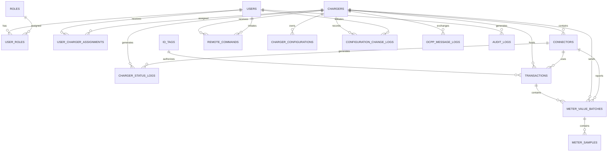

# VOLTRIC – Database Design and Entity Relationship Diagram

**Project:** VOLTRIC – EV Charging Station Management System  
**Document:** Database Design and ERD  
**Version:** 1.0  
**Database:** MySQL 8.x  
**Architecture:** Feature-Based Modular Monolith  
**Protocol:** OCPP 1.6J  
**Organization Model:** Single organization

---

## 1. Purpose

This document defines the logical database design for VOLTRIC V1.

It identifies the required database tables, their columns, primary keys, foreign keys, relationships, constraints, indexes, and data-management rules.

The database must support:

- CMS user and role management.
- Charger registration and monitoring.
- Connector management.
- RFID/idTag authorization.
- Charging transaction lifecycle.
- Meter value and telemetry storage.
- Remote charger commands.
- Charger configuration management.
- OCPP communication logging.
- CMS audit logging.

The database design follows the feature-based modular monolith architecture defined in Step 7.

## 2. Database Standards

| Property | Standard |
|---|---|
| Database engine | MySQL 8.x |
| Storage engine | InnoDB |
| Character set | utf8mb4 |
| Collation | utf8mb4_unicode_ci, with explicit case-sensitive handling where required |
| Internal primary keys | BIGINT AUTO_INCREMENT |
| OCPP transaction ID | INT |
| Timestamp storage | UTC |
| Date/time type | DATETIME(3) |
| Decimal measurements | DECIMAL |
| Schema migration | Flyway |
| ORM | Hibernate / Spring Data JPA |

### 2.1 Important conventions

1. Every table should have a primary key.
2. Foreign keys should enforce relationships between business records.
3. Use `created_at` and `updated_at` on mutable business records where useful.
4. Store timestamps consistently in UTC.
5. Do not store passwords in plain text.
6. Use appropriate indexes for frequently queried columns.
7. Use `DECIMAL`, not floating-point types, for persisted electrical measurements where precision matters.
8. Use JSON columns only where retaining flexible protocol payloads is more suitable than creating fixed columns.
9. Avoid hard deletion of historical transactions, meter readings and audit records.
10. Do not introduce tenant or organization tables in V1.

## 3. Entity Relationship Diagram



**Relationship note:** `CHARGER_STATUS_LOGS` can record a charge-point-level status event with no physical connector association. In that case, its `connector_id` is NULL and its original OCPP connector ID is retained separately.

## 4. Authentication Module

### 4.1 USERS

Stores CMS user account information.

| Column | Data type | Constraint | Description |
|---|---|---|---|
| id | BIGINT | PK, AUTO_INCREMENT | Internal user ID |
| full_name | VARCHAR(100) | NOT NULL | User's name |
| email | VARCHAR(150) | UNIQUE, NOT NULL | Login email |
| password_hash | VARCHAR(255) | NOT NULL | Hashed password |
| is_active | BOOLEAN | NOT NULL, DEFAULT TRUE | Account status |
| created_at | DATETIME(3) | NOT NULL | Account creation time |
| updated_at | DATETIME(3) | NULL | Last update time |

**Business rules:**

- Email must be unique.
- Passwords must be securely hashed.
- Inactive users cannot authenticate.
- Users should be deactivated rather than deleted when historical audit references must be preserved.

### 4.2 ROLES

Stores available CMS roles.

| Column | Data type | Constraint | Description |
|---|---|---|---|
| id | BIGINT | PK, AUTO_INCREMENT | Role ID |
| role_name | VARCHAR(50) | UNIQUE, NOT NULL | Role name |
| description | VARCHAR(255) | NULL | Role description |

Initial roles:

- SUPER_ADMIN
- CHARGING_STATION_OPERATOR
- SYSTEM_ADMIN

The System Administrator role does not automatically grant CMS business permissions.

### 4.3 USER_ROLES

Maps users to roles.

| Column | Data type | Constraint | Description |
|---|---|---|---|
| id | BIGINT | PK, AUTO_INCREMENT | Mapping ID |
| user_id | BIGINT | FK, NOT NULL | References USERS |
| role_id | BIGINT | FK, NOT NULL | References ROLES |

Unique constraint: `(user_id, role_id)`.

## 5. User Module

### 5.1 USER_CHARGER_ASSIGNMENTS

Defines which charging stations an operator is permitted to manage.

| Column | Data type | Constraint | Description |
|---|---|---|---|
| id | BIGINT | PK, AUTO_INCREMENT | Assignment ID |
| user_id | BIGINT | FK, NOT NULL | Assigned user |
| charger_id | BIGINT | FK, NOT NULL | Assigned charger |
| assigned_by | BIGINT | FK, NULL | User who created assignment |
| assigned_at | DATETIME(3) | NOT NULL | Assignment time |

Unique constraint: `(user_id, charger_id)`.

This supports operator access restricted to assigned charging stations.

## 6. Charger Module

### 6.1 CHARGERS

Stores registered charging station information.

| Column | Data type | Constraint | Description |
|---|---|---|---|
| id | BIGINT | PK, AUTO_INCREMENT | Internal charger ID |
| charge_point_id | VARCHAR(100) | UNIQUE, NOT NULL | OCPP charger identity |
| charger_name | VARCHAR(100) | NULL | Display name |
| vendor | VARCHAR(100) | NULL | Manufacturer |
| model | VARCHAR(100) | NULL | Charger model |
| serial_number | VARCHAR(100) | NULL | Serial number |
| firmware_version | VARCHAR(100) | NULL | Firmware version |
| registration_status | VARCHAR(30) | NOT NULL | Registration state |
| connection_status | VARCHAR(30) | NOT NULL | Current communication state |
| last_heartbeat_at | DATETIME(3) | NULL | Last received heartbeat |
| registered_at | DATETIME(3) | NULL | Registration time |
| created_at | DATETIME(3) | NOT NULL | Record creation time |
| updated_at | DATETIME(3) | NULL | Last update time |

Suggested registration states:

- PENDING
- APPROVED
- REJECTED
- DISABLED

Suggested connection states:

- CONNECTED
- DISCONNECTED
- RECONNECTING

**Important:** Charger connection status is not the same as charger operational status. Operational information is received through OCPP status notifications and must be represented separately.

### 6.2 CHARGER_STATUS_LOGS

Stores charger and connector status history.

| Column | Data type | Constraint | Description |
|---|---|---|---|
| id | BIGINT | PK, AUTO_INCREMENT | Log ID |
| charger_id | BIGINT | FK, NOT NULL | Charger |
| connector_id | BIGINT | FK, NULL | Physical connector, if applicable |
| protocol_connector_id | INT | NOT NULL | Original OCPP connectorId |
| status | VARCHAR(40) | NOT NULL | OCPP status |
| error_code | VARCHAR(80) | NULL | OCPP error code |
| info | VARCHAR(500) | NULL | Additional information |
| vendor_error_code | VARCHAR(100) | NULL | Vendor-specific error |
| occurred_at | DATETIME(3) | NOT NULL | Event timestamp |
| received_at | DATETIME(3) | NOT NULL | CMS receipt timestamp |

`protocol_connector_id = 0` represents a charge-point-level status event. Do not create a physical connector record with ID 0 merely to accommodate this event.

## 7. Connector Module

### 7.1 CONNECTORS

Stores connector information for each charger.

| Column | Data type | Constraint | Description |
|---|---|---|---|
| id | BIGINT | PK, AUTO_INCREMENT | Internal connector ID |
| charger_id | BIGINT | FK, NOT NULL | Parent charger |
| connector_number | INT | NOT NULL | OCPP connectorId |
| connector_status | VARCHAR(40) | NOT NULL | Operational status |
| last_status_update | DATETIME(3) | NULL | Last status event |
| created_at | DATETIME(3) | NOT NULL | Creation time |
| updated_at | DATETIME(3) | NULL | Last update time |

Unique constraint: `(charger_id, connector_number)`.

OCPP connector IDs for physical connectors start at 1. Connector ID 0 is reserved for charge-point-level messages.

Suggested operational statuses:

- AVAILABLE
- PREPARING
- CHARGING
- SUSPENDED_EV
- SUSPENDED_EVSE
- FINISHING
- RESERVED
- UNAVAILABLE
- FAULTED

These are OCPP 1.6 status values, not CMS communication states.

## 8. Authorization Module

### 8.1 ID_TAGS

Stores RFID identifiers used to authorize charging sessions.

| Column | Data type | Constraint | Description |
|---|---|---|---|
| id | BIGINT | PK, AUTO_INCREMENT | Internal record ID |
| id_tag | VARCHAR(20) | UNIQUE, NOT NULL | OCPP idTag |
| status | VARCHAR(30) | NOT NULL | Authorization status |
| expiry_date | DATETIME(3) | NULL | Expiry time |
| parent_id_tag | VARCHAR(20) | NULL | Parent identifier |
| created_at | DATETIME(3) | NOT NULL | Creation time |
| updated_at | DATETIME(3) | NULL | Last update time |

The OCPP 1.6 idTag field has a maximum length of 20 characters.

The parent identifier can be used for parent/child authorization arrangements where supported by the business rules.

Suggested statuses:

- ACTIVE
- BLOCKED
- EXPIRED
- DISABLED

## 9. Transaction Module

### 9.1 TRANSACTIONS

Stores charging session information.

| Column | Data type | Constraint | Description |
|---|---|---|---|
| id | BIGINT | PK, AUTO_INCREMENT | Internal database ID |
| ocpp_transaction_id | INT | UNIQUE, NOT NULL | OCPP transaction ID |
| charger_id | BIGINT | FK, NOT NULL | Charging station |
| connector_id | BIGINT | FK, NOT NULL | Physical connector |
| id_tag_id | BIGINT | FK, NULL | Authorized idTag |
| id_tag_value | VARCHAR(20) | NOT NULL | idTag received at start |
| status | VARCHAR(30) | NOT NULL | Transaction lifecycle state |
| meter_start | DECIMAL(18,3) | NOT NULL | Starting meter reading |
| meter_stop | DECIMAL(18,3) | NULL | Ending meter reading |
| started_at | DATETIME(3) | NOT NULL | Start timestamp |
| stopped_at | DATETIME(3) | NULL | Stop timestamp |
| stop_reason | VARCHAR(50) | NULL | OCPP stop reason |
| energy_consumed | DECIMAL(18,3) | NULL | Calculated energy |
| created_at | DATETIME(3) | NOT NULL | Record creation time |
| updated_at | DATETIME(3) | NULL | Last update time |

Suggested transaction states:

- ACTIVE
- COMPLETED
- RECOVERY_PENDING

**Important transaction rules:**

1. The CMS generates the OCPP transaction ID when processing StartTransaction.
2. The transaction ID returned in the OCPP response must fit the protocol's integer range.
3. A transaction must be associated with a valid charger and physical connector.
4. A connector should not have two simultaneously active transactions.
5. A StopTransaction request must refer to a valid transaction.
6. Completed transactions must retain their historical data.
7. Energy consumed should be calculated from validated meter readings and units.
8. A lost charger connection must not automatically mark an active transaction as completed.

### Active transaction uniqueness

MySQL does not support ordinary partial unique indexes in the same way some other databases do.

To enforce one active transaction per connector robustly, V1 can use an additional table:

**ACTIVE_CONNECTOR_SESSIONS**

| Column | Data type | Constraint | Description |
|---|---|---|---|
| connector_id | BIGINT | PK, FK | Active connector |
| transaction_id | BIGINT | UNIQUE, FK, NOT NULL | Active transaction |
| started_at | DATETIME(3) | NOT NULL | Session start |

The application creates this row in the same database transaction that activates a charging session. It removes the row when the session is completed. The primary key on `connector_id` prevents two active sessions from claiming the same connector.

This table is part of the recommended logical design and brings the initial logical table count to 17.

## 10. Meter Value Module

### 10.1 METER_VALUE_BATCHES

Stores each incoming OCPP MeterValues request and its individual meter-value timestamps.

| Column | Data type | Constraint | Description |
|---|---|---|---|
| id | BIGINT | PK, AUTO_INCREMENT | Batch record ID |
| charger_id | BIGINT | FK, NOT NULL | Reporting charger |
| connector_id | BIGINT | FK, NOT NULL | Reporting connector |
| transaction_id | BIGINT | FK, NULL | Related transaction |
| sampled_at | DATETIME(3) | NOT NULL | OCPP MeterValue timestamp |
| received_at | DATETIME(3) | NOT NULL | CMS receipt time |
| created_at | DATETIME(3) | NOT NULL | Record creation time |

### 10.2 METER_SAMPLES

Stores individual sampled values inside a meter-value batch.

| Column | Data type | Constraint | Description |
|---|---|---|---|
| id | BIGINT | PK, AUTO_INCREMENT | Sample ID |
| batch_id | BIGINT | FK, NOT NULL | Parent batch |
| value | VARCHAR(100) | NOT NULL | Raw OCPP value |
| context | VARCHAR(40) | NULL | Sample context |
| format | VARCHAR(30) | NULL | Raw or signed data |
| measurand | VARCHAR(80) | NULL | Energy, power, voltage, etc. |
| phase | VARCHAR(20) | NULL | Electrical phase |
| location | VARCHAR(30) | NULL | Measurement location |
| unit | VARCHAR(20) | NULL | Wh, kWh, W, A, V, etc. |

**Why two tables?**

One OCPP MeterValues message can contain multiple MeterValue entries, and each entry can contain multiple SampledValue entries.

The parent-child design preserves this structure instead of flattening away the original grouping.

For example, a single message may contain:

- Energy.Active.Import.Register
- Power.Active.Import
- Current.Import
- Voltage

Each sampled value becomes an individual row in METER_SAMPLES.

The raw value is retained so that the original protocol representation is not lost. The service can parse supported measurements into numeric values when performing calculations.

## 11. Remote Command Module

### 11.1 REMOTE_COMMANDS

Stores CMS-initiated commands sent to chargers.

| Column | Data type | Constraint | Description |
|---|---|---|---|
| id | BIGINT | PK, AUTO_INCREMENT | Internal command ID |
| charger_id | BIGINT | FK, NOT NULL | Target charger |
| requested_by | BIGINT | FK, NULL | CMS user |
| message_id | VARCHAR(100) | UNIQUE, NOT NULL | OCPP request correlation ID |
| action | VARCHAR(50) | NOT NULL | OCPP action |
| connector_number | INT | NULL | Target connector, when relevant |
| request_payload | JSON | NULL | Outgoing payload |
| response_payload | JSON | NULL | Received response |
| status | VARCHAR(30) | NOT NULL | Command state |
| requested_at | DATETIME(3) | NOT NULL | Creation time |
| sent_at | DATETIME(3) | NULL | Send time |
| responded_at | DATETIME(3) | NULL | Response time |
| timeout_at | DATETIME(3) | NULL | Timeout deadline |
| error_message | VARCHAR(500) | NULL | Failure details |

Suggested command states:

- PENDING
- SENT
- ACCEPTED
- REJECTED
- FAILED
- TIMEOUT

The exact state transitions must be defined in the remote command service.

**Important:** ACCEPTED means the charger accepted the command at the protocol level. It does not necessarily mean the requested business operation has completed.

## 12. Configuration Module

### 12.1 CHARGER_CONFIGURATIONS

Stores the CMS-known configuration values for each charger.

| Column | Data type | Constraint | Description |
|---|---|---|---|
| id | BIGINT | PK, AUTO_INCREMENT | Configuration ID |
| charger_id | BIGINT | FK, NOT NULL | Charger |
| configuration_key | VARCHAR(100) | NOT NULL | OCPP configuration key |
| configuration_value | VARCHAR(500) | NULL | Stored value |
| readonly | BOOLEAN | NOT NULL, DEFAULT FALSE | Read-only flag |
| updated_at | DATETIME(3) | NULL | Last update time |

Unique constraint: `(charger_id, configuration_key)`.

### 12.2 CONFIGURATION_CHANGE_LOGS

Stores configuration change requests and their outcomes.

| Column | Data type | Constraint | Description |
|---|---|---|---|
| id | BIGINT | PK, AUTO_INCREMENT | Log ID |
| charger_id | BIGINT | FK, NOT NULL | Target charger |
| requested_by | BIGINT | FK, NULL | CMS user |
| configuration_key | VARCHAR(100) | NOT NULL | Configuration key |
| old_value | VARCHAR(500) | NULL | Previous value |
| requested_value | VARCHAR(500) | NOT NULL | Requested value |
| result | VARCHAR(30) | NOT NULL | OCPP result |
| requested_at | DATETIME(3) | NOT NULL | Request time |
| responded_at | DATETIME(3) | NULL | Response time |

The current configuration table and change history table serve different purposes: one stores the latest known value, while the other preserves change history.

## 13. OCPP Communication Module

### 13.1 OCPP_MESSAGE_LOGS

Stores OCPP message communication records.

| Column | Data type | Constraint | Description |
|---|---|---|---|
| id | BIGINT | PK, AUTO_INCREMENT | Log ID |
| charger_id | BIGINT | FK, NULL | Identified charger |
| message_id | VARCHAR(100) | NULL | OCPP message ID |
| action | VARCHAR(50) | NULL | OCPP action |
| frame_type | VARCHAR(20) | NOT NULL | CALL, CALLRESULT, CALLERROR |
| direction | VARCHAR(20) | NOT NULL | INBOUND or OUTBOUND |
| payload | JSON | NULL | Message payload |
| processing_status | VARCHAR(30) | NOT NULL | Processing result |
| error_details | VARCHAR(1000) | NULL | Processing error |
| occurred_at | DATETIME(3) | NOT NULL | Message time |

OCPP message logs can grow quickly. They should have a defined retention policy, appropriate indexes, and access controls.

Do not store sensitive authentication material or credentials in unrestricted message logs.

## 14. Common / Audit Module

### 14.1 AUDIT_LOGS

Tracks important CMS user activities.

| Column | Data type | Constraint | Description |
|---|---|---|---|
| id | BIGINT | PK, AUTO_INCREMENT | Audit ID |
| user_id | BIGINT | FK, NULL | Acting CMS user |
| action | VARCHAR(100) | NOT NULL | Activity name |
| entity_type | VARCHAR(80) | NULL | Affected record type |
| entity_id | VARCHAR(100) | NULL | Affected record ID |
| description | VARCHAR(500) | NULL | Activity details |
| ip_address | VARCHAR(45) | NULL | Client IP address |
| occurred_at | DATETIME(3) | NOT NULL | Activity timestamp |

Audit logs should capture important operations such as:

- User creation and deactivation.
- Charger registration and configuration.
- Remote command requests.
- idTag changes.
- Permission changes.

## 15. Indexing Strategy

Indexes should support common application queries without creating unnecessary write overhead.

| Table | Index / Constraint | Purpose |
|---|---|---|
| users | UNIQUE(email) | Login lookup |
| user_roles | UNIQUE(user_id, role_id) | Prevent duplicate roles |
| chargers | UNIQUE(charge_point_id) | Charger identity lookup |
| chargers | INDEX(connection_status) | Connection monitoring |
| connectors | UNIQUE(charger_id, connector_number) | Connector lookup |
| id_tags | UNIQUE(id_tag) | Authorization lookup |
| transactions | UNIQUE(ocpp_transaction_id) | OCPP transaction lookup |
| transactions | INDEX(charger_id, started_at) | Charger history |
| transactions | INDEX(connector_id, status) | Connector session lookup |
| meter_value_batches | INDEX(charger_id, sampled_at) | Telemetry history |
| meter_samples | INDEX(batch_id) | Retrieve samples |
| remote_commands | UNIQUE(message_id) | Request correlation |
| remote_commands | INDEX(charger_id, status) | Pending command lookup |
| ocpp_message_logs | INDEX(charger_id, occurred_at) | Charger message history |
| charger_status_logs | INDEX(charger_id, occurred_at) | Status history |
| audit_logs | INDEX(user_id, occurred_at) | User activity history |

Foreign keys should also be indexed appropriately. Verify actual query plans with `EXPLAIN` after the application has representative data.

## 16. Data Integrity and Lifecycle Rules

### 16.1 Transaction consistency

When processing StartTransaction:

1. Validate the charger and connector.
2. Validate the idTag according to authorization rules.
3. Ensure that the connector does not already have an active session.
4. Create the transaction.
5. Create the active connector session.
6. Commit both records atomically.
7. Return the assigned OCPP transaction ID.

When processing StopTransaction:

1. Find the transaction using the OCPP transaction ID.
2. Validate that it is active.
3. Store the stop timestamp and final meter reading.
4. Update the transaction state.
5. Remove the active connector session.
6. Commit the changes atomically.

### 16.2 Meter reading consistency

- Preserve original units and sampled values.
- Validate numeric values before using them in calculations.
- Convert Wh to kWh only when the measurand and unit establish that conversion is valid.
- Retain the original sample timestamp and CMS receipt timestamp.
- Handle out-of-order and duplicate meter readings deliberately.

### 16.3 Historical data

Historical transactions, meter samples, OCPP logs and audit logs should not be casually deleted.

Retention and archival policies must be established before production deployment.

## 17. Database Migration Strategy

Flyway will manage all schema changes.

Proposed migration structure:

```text
src/main/resources/db/migration/
│
├── V1__create_user_and_role_tables.sql
├── V2__create_charger_and_connector_tables.sql
├── V3__create_authorization_tables.sql
├── V4__create_transaction_tables.sql
├── V5__create_meter_value_tables.sql
├── V6__create_remote_command_tables.sql
├── V7__create_configuration_tables.sql
├── V8__create_ocpp_and_audit_logs.sql
└── V9__add_indexes_and_constraints.sql
```

Migration names are illustrative. The final sequence should reflect the actual dependency order of the tables.

Once a migration has been applied to a shared environment, do not silently edit it. Create a new migration for subsequent schema changes.

## 18. V1 Scope Boundaries

Included:

- Single-organization CMS data.
- CMS users and roles.
- Charger and connector records.
- RFID authorization.
- Charging transactions.
- Meter value storage.
- Remote commands.
- Charger configurations.
- OCPP message history.
- Audit logs.

Excluded:

- Multi-tenant organization tables.
- Payment and billing tables.
- EV roaming records.
- Driver mobile application data.
- Smart charging schedules.
- Firmware update packages and deployment records.
- OCPP 2.0.1-specific data structures.

## 19. Acceptance Criteria

Step 8 is complete when:

1. All V1 database tables are identified.
2. Each table has defined columns and data types.
3. Primary keys and foreign keys are specified.
4. Table relationships are documented in the ERD.
5. Transaction uniqueness is addressed.
6. MeterValues are modeled without losing the OCPP message structure.
7. Remote command correlation is supported.
8. Indexes and constraints are identified.
9. UTC timestamp and measurement-unit rules are documented.
10. The document is reviewed and merged into `main`.

---

**End of Document – VOLTRIC Database Design and ERD**